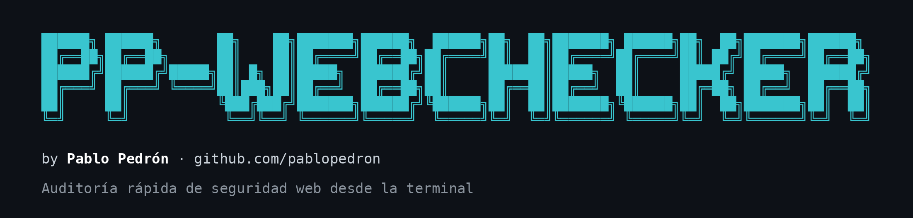
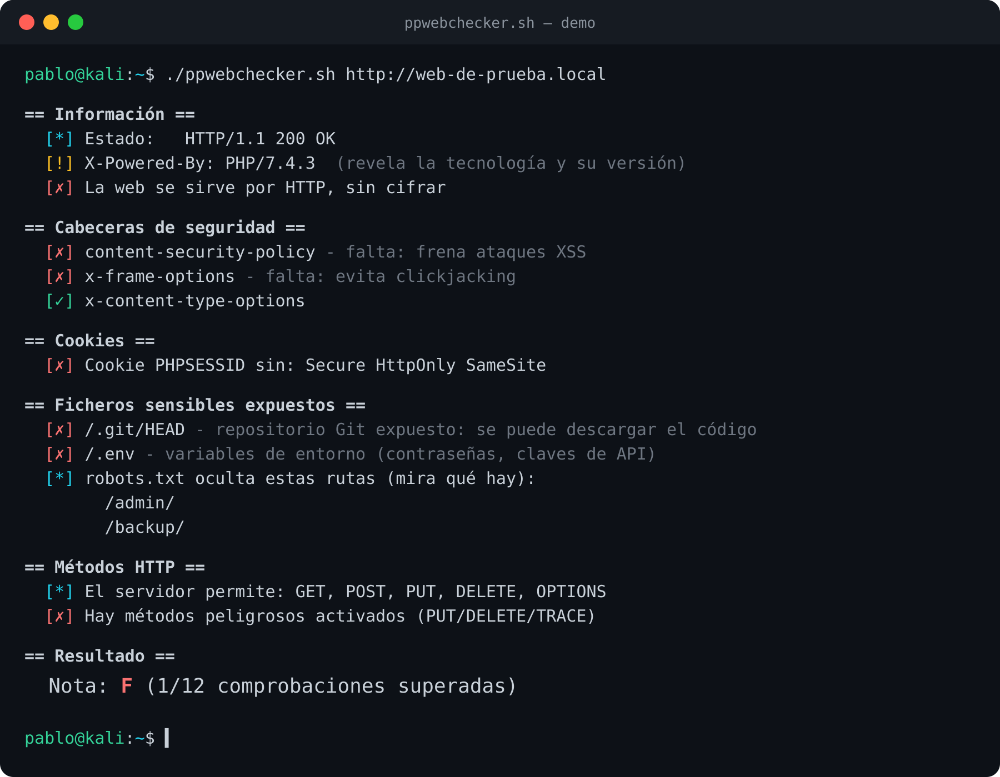

Script en Bash que revisa la configuración de seguridad de una web: cabeceras de seguridad, cookies, ficheros sensibles expuestos (`.git`, `.env`, `phpinfo`…) y métodos HTTP peligrosos. Al final da una nota de la A a la F.



## Uso

```bash
chmod +x ppwebchecker.sh
./ppwebchecker.sh https://ejemplo.com
```

Solo necesita Bash y curl.

## Aviso

Úsalo solo en webs tuyas o con permiso.
